# Enterprise Branch Network Design & Implementation

A Cisco Packet Tracer portfolio project that designs, secures, and troubleshoots a small enterprise branch network with two office segments, centralized network services, dynamic routing, VoIP, edge NAT/PAT, and management controls.

**Author:** Emmanuel Owens  
**Platform:** Cisco Packet Tracer  
**Focus:** Switching, routing, network services, security, VoIP, and troubleshooting

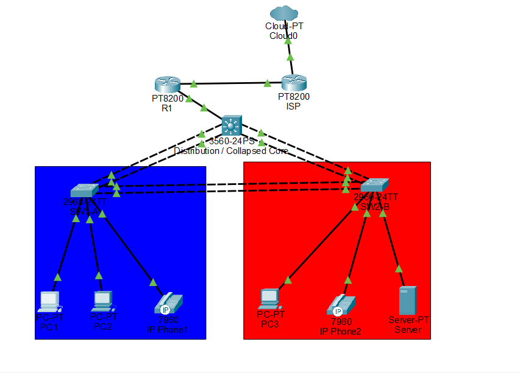

## Project Goals

This project was built to move beyond isolated CCNA labs and practice how multiple technologies operate together in one network. The design emphasizes practical configuration, verification, and troubleshooting rather than scale for its own sake.

Key objectives:

- Segment users and services with VLANs.
- Provide resilient Layer 2 paths with LACP EtherChannel and Rapid PVST+.
- Route between VLANs on a multilayer distribution switch.
- Centralize DHCP and DNS services.
- Exchange routes dynamically with single-area OSPF.
- Provide Cisco CME/TFTP-based IP telephony.
- Provide WAN reachability through NAT/PAT.
- Synchronize infrastructure clocks with NTP.
- Restrict management access and user traffic with ACLs and SSH controls.
- Apply access-layer protections such as Port Security, PortFast, and BPDU Guard.
- Troubleshoot real service failures and document the root cause.

## Topology

The branch uses a collapsed-core/distribution design:

```text
                           Cloud / Internet
                                  |
                               ISP-R1
                                  |
                                  R1
                                  |
                              DIST-SW
                           /      |      \
                       SW1-A =====+===== SW2-B
                       / | \             / | \
                    PC1 PC2 Phone1    PC3 Phone2 Server
```

- **R1:** enterprise edge router, OSPF peer, NAT/PAT edge, CME/TFTP, NTP master
- **ISP-R1:** simulated service-provider next hop
- **DIST-SW:** Cisco 3560 multilayer switch acting as collapsed core/distribution
- **SW1-A / SW2-B:** Cisco 2960 access switches
- **Server:** centralized DHCP/DNS at `10.10.40.10`
- **Phone1 / Phone2:** Cisco 7960 phones using extensions `1001` and `1002`

## VLAN and IP Plan

| VLAN | Name | Subnet | Gateway | Primary Use |
|---:|---|---|---|---|
| 10 | IT | `10.10.10.0/24` | `10.10.10.1` | Office A IT users |
| 20 | SALES | `10.10.20.0/24` | `10.10.20.1` | Office A sales users |
| 30 | FINANCE | `10.10.30.0/24` | `10.10.30.1` | Office B finance users |
| 40 | SERVERS | `10.10.40.0/24` | `10.10.40.1` | DHCP/DNS server |
| 50 | VOICE | `10.10.50.0/24` | `10.10.50.1` | IP phones |
| 99 | MANAGEMENT | `10.10.99.0/24` | `10.10.99.1` | Switch management |
| 1000 | NATIVE_UNUSED | — | — | Unused trunk native VLAN |

Additional routed addressing:

| Link / Interface | Address |
|---|---|
| R1 ↔ DIST-SW | `10.10.254.0/30` |
| R1 Loopback0 | `10.255.0.1/32` |
| DIST-SW Loopback0 | `10.255.0.2/32` |
| R1 ↔ ISP-R1 | `203.0.113.0/30` |
| R1 WAN | `203.0.113.2/30` |
| ISP-R1 next hop | `203.0.113.1/30` |

## Layer 2 Design

### LACP EtherChannel

Three LACP EtherChannels provide aggregated/redundant switch links:

- **Po1:** DIST-SW ↔ SW1-A
- **Po2:** DIST-SW ↔ SW2-B
- **Po3:** SW1-A ↔ SW2-B

Trunks use static 802.1Q configuration, disable DTP with `switchport nonegotiate`, use VLAN 1000 as the unused native VLAN, and prune VLANs according to each office's requirements.

### Spanning Tree

- Rapid PVST+ is enabled.
- DIST-SW is the root bridge for VLANs 10, 20, 30, 40, 50, and 99.
- PortFast and BPDU Guard are enabled on end-host access ports.

## Inter-VLAN Routing

DIST-SW provides Layer 3 gateways through SVIs and has `ip routing` enabled. DHCP relay is configured on client/voice SVIs using `ip helper-address 10.10.40.10`.

## DHCP and DNS

The server at `10.10.40.10` provides centralized DHCP and DNS.

DHCP pools provide addressing to IT, Sales, Finance, and Voice clients. DNS records include:

- `emmanuel.com` → `10.10.40.10` (A record)
- `www.emmanuel.com` → `emmanuel.com` (CNAME)

Successful name resolution:

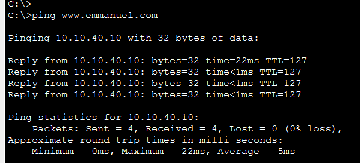

## OSPF Dynamic Routing

R1 and DIST-SW run single-area OSPF in Area 0.

- R1 router ID: `10.255.0.1`
- DIST-SW router ID: `10.255.0.2`
- R1 advertises its default route toward DIST-SW.
- DIST-SW advertises the internal VLAN networks and its loopback.
- Client-facing SVIs are passive to avoid unnecessary neighbor formation.

R1 neighbor state:

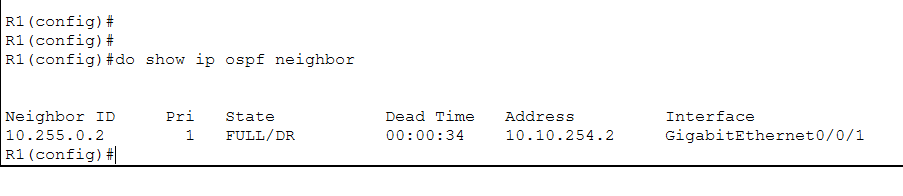

DIST-SW neighbor state:

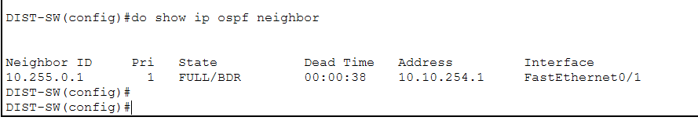

Both devices reached a **FULL** OSPF adjacency.

## NAT/PAT

R1 performs PAT (NAT overload) for internal `10.10.0.0/16` addresses using its WAN interface address `203.0.113.2`.

```cisco
ip nat inside source list 1 interface GigabitEthernet0/0/0 overload
```

A default route points toward ISP-R1 at `203.0.113.1`, and R1 originates the default into OSPF.

The live translation table shows private inside-local traffic being represented by the outside interface address:

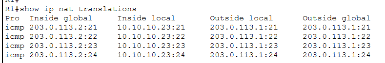

## VoIP with Cisco CME

R1 provides Cisco Unified Communications Manager Express (CME) functionality for two Cisco 7960 phones.

| Phone | CME Object | Extension |
|---|---:|---:|
| Phone1 | ephone 1 | 1001 |
| Phone2 | ephone 2 | 1002 |

The phones use the Voice VLAN and learn the TFTP/CME location through DHCP. Both phones registered successfully and completed calls between extensions.

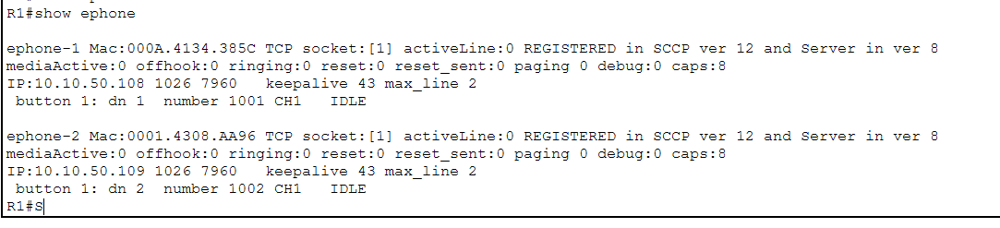

## NTP

R1 acts as an authenticated internal NTP master (stratum 5). Infrastructure devices were configured as authenticated NTP clients. Packet Tracer had limitations around using the loopback as the NTP source, so validation used R1's reachable inside address `10.10.254.1`.

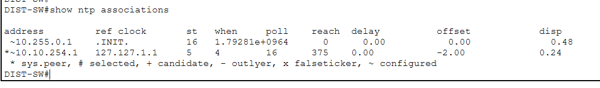

## Security Controls

### Extended ACL

The `SALES_TO_FINANCE` extended ACL permits ICMP from Sales (`10.10.20.0/24`) to Finance (`10.10.30.0/24`), denies other IP traffic between those subnets, and permits unrelated traffic.

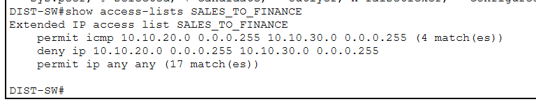

### Port Security

Port Security uses sticky MAC learning, a maximum of one secure MAC on selected PC/server access ports, and **restrict** violation mode.

SW1-A:

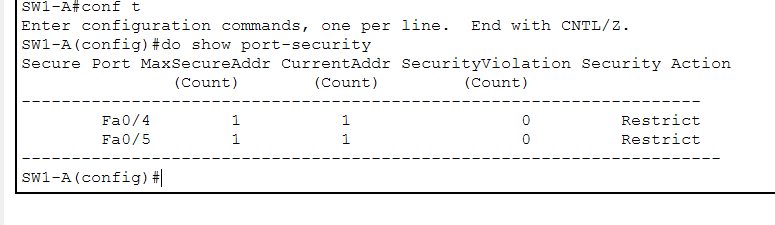

SW2-B:

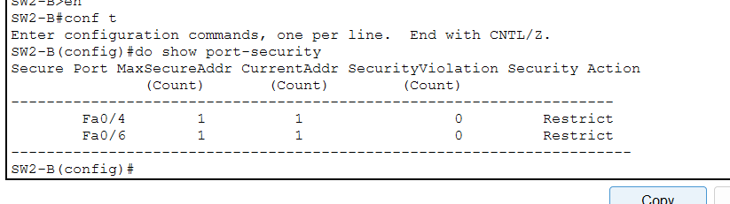

### SSH Management Restriction

Remote management is protected with SSH and a standard VTY ACL that permits only IT VLAN 10 (`10.10.10.0/24`).

IT VLAN SSH succeeds:

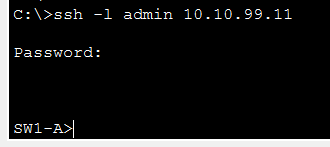

Non-IT SSH is denied/closed:

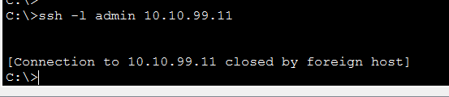

### DHCP Snooping and DAI

DHCP Snooping and Dynamic ARP Inspection were configured and tested during the hardening phase. During final troubleshooting, Packet Tracer's behavior with DHCP Snooping over EtherChannel caused legitimate DHCP client traffic to fail. The features were therefore disabled in the stable final simulation while the working security design and troubleshooting findings were retained in the documentation.

## Troubleshooting Case Study: DHCP Failure After Security Hardening

A useful failure occurred after enabling DHCP Snooping/DAI. Multiple clients stopped receiving valid leases and self-assigned APIPA addresses in `169.254.0.0/16`.

Before remediation:

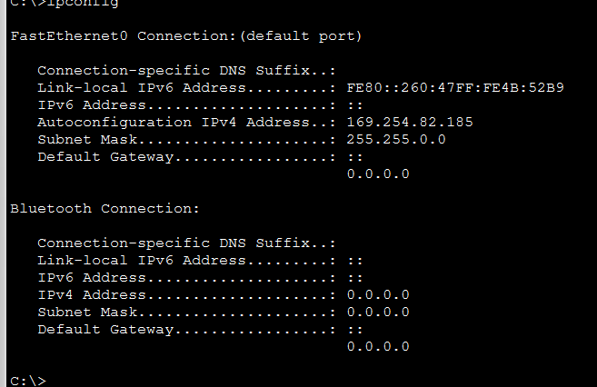

Troubleshooting process:

1. Verified DIST-SW SVIs were up/up.
2. Verified `ip helper-address 10.10.40.10` remained configured.
3. Verified the DHCP/DNS server retained `10.10.40.10/24` with gateway `10.10.40.1`.
4. Verified the DHCP server-facing switchport was trusted.
5. Observed an empty DHCP Snooping binding table while clients remained on APIPA.
6. Temporarily disabled DHCP Snooping to isolate the security feature from the rest of the DHCP path.
7. Renewed the client lease and immediately restored normal addressing.

After remediation:

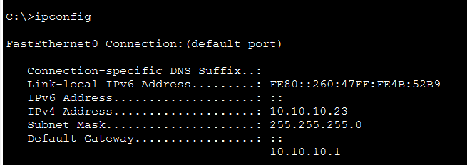

**Root cause:** Packet Tracer's DHCP Snooping behavior with the EtherChannel-based topology prevented the simulated DHCP exchange from completing correctly. Disabling the feature restored service.

**Lesson learned:** Troubleshooting should isolate shared dependencies before changing unrelated routing or endpoint configuration. A `169.254.x.x` client address is a strong indicator to investigate DHCP first.

## Verification Commands

Useful commands used throughout the project:

```cisco
show ip interface brief
show vlan brief
show interfaces trunk
show etherchannel summary
show spanning-tree
show ip ospf neighbor
show ip route ospf
show ip nat translations
show ip nat statistics
show ephone
show ntp associations
show access-lists
show port-security
show ip dhcp snooping
show ip dhcp snooping binding
show ip arp inspection
```

## Repository Structure

```text
enterprise-branch-network-portfolio/
├── README.md
├── configs/
│   ├── R1.txt
│   ├── DIST-SW.txt
│   ├── SW1-A.txt
│   └── SW2-B.txt
├── docs/
│   ├── troubleshooting.md
│   └── verification-checklist.md
├── packet-tracer/
│   └── enterprise-branch-network.pkt
└── screenshots/
    └── verification evidence
```

> **Security note:** Public configuration exports are sanitized. Authentication secrets/password hashes are intentionally redacted.

## Skills Demonstrated

- VLAN design and subnetting
- 802.1Q trunking and VLAN pruning
- LACP EtherChannel
- Rapid PVST+, PortFast, and BPDU Guard
- Multilayer switching and SVIs
- Inter-VLAN routing
- DHCP relay and centralized DHCP
- DNS A/CNAME records
- Single-area OSPF
- Default-route propagation
- NAT/PAT overload
- Cisco CME/TFTP/IP telephony
- NTP synchronization
- Standard and extended ACLs
- Port Security and sticky MAC learning
- SSH management controls
- DHCP Snooping/DAI testing
- Structured network troubleshooting

## Future Improvements

Possible V2/V3 enhancements:

- Add a second multilayer switch and HSRP for gateway redundancy.
- Expand OSPF into a larger routed topology.
- Add a dedicated firewall/security appliance.
- Revisit DHCP Snooping/DAI on hardware or a simulator that fully supports the EtherChannel behavior.
- Extend the topology into Azure/AWS and automate infrastructure with Terraform.
- Add centralized logging/monitoring and SNMP.

## Files

The Packet Tracer project is included under [`packet-tracer/`](packet-tracer/), and sanitized device configuration exports are under [`configs/`](configs/).
